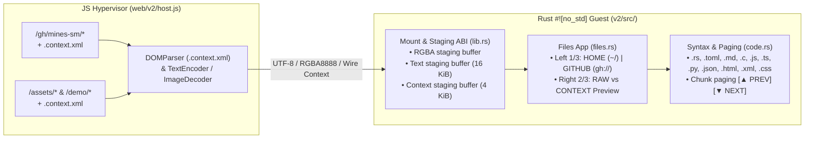

# Implementation Plan: GitHub On-Demand Mounts & Enriched `.context.xml` Sub-Agent Context Preview

## 1. Executive Summary & Architectural Philosophy

This document specifies the design and parallel sub-agent implementation plan for folding two high-leverage testing seams into the **`wasm-fb` `/v2/` `#![no_std]` Rust WebAssembly Framebuffer Appliance**:

1. **Seam #1 — GitHub On-Demand Code Context (`gh://`):**
   - Extends the `Files` application into two top-level sections: **`HOME (~/)`** (containing `wallpapers/` and `samples/`) and **`GITHUB (gh://)`** (task-scoped repository files provided on demand by the JS hypervisor, starting with `jpeckenpaugh/mines-sm` for the `Mines` testing workflow).
   - Just as the JS hypervisor acts as an upstream `RGBA8888` image decoder so we never bloat the `.wasm` binary with image codecs or raw PNGs, it acts as a **GitHub Index + On-Demand Chunk Upstream**. The guest receives a lightweight file tree manifest and stages UTF-8 code chunks only when a file is selected or paged.

2. **Seam #2 — Enriched OS Metadata & Knowledge Graph Sidecars (`.context.xml`):**
   - Pre-computes the "grounding / research sub-agent" task at the OS/hypervisor level using a fast frontier model (e.g., `deepseek-v4.1-flash`) and stores the output in a hidden **`.context.xml`** sidecar file inside each mounted directory (`gh/mines-sm/.context.xml`, `demo/.context.xml`, `assets/.context.xml`).
   - Each `.context.xml` entry contains:
     1. **Mini Knowledge Graph:** `runtime`, `role`, `imports`, `exports`, `dependents`, and `invariants`.
     2. **Technical Summary (1–2 paragraphs):** What the file does and how it fits into the broader system architecture.
   - Inside the `Files` app's **Right 2/3 Preview Pane**, clicking the **`[ CONTEXT ]` / `[ RAW ]`** toggle button (or pressing `Tab` / `I`, or selecting `FILES -> TOGGLE CONTEXT VIEW` from the Title Bar) switches the preview between the raw file content (image or syntax-highlighted source code) and its structured **Context Thumbnail + Knowledge Graph**—giving a Beta Tester Agent instant architectural grounding with zero wasted tokens.

### Strict Architectural Invariants ("Less is More")
- **Single Flat Maximized Surface:** All rendering happens directly on the flat client surface below the 32px Title Bar (`fb.sub_rows(TITLE_H, client_h)`). **No nested window frames, no fake inner title bars, and no duplicate status strings.**
- **Zero Static Bloat in `.wasm`:** No user files, GitHub files, or `.context.xml` strings may be baked into `v2/src/*.rs`. All files and context sidecars live on the host web server and are staged into guest linear memory at runtime by `web/v2/host.js`.
- **Rust 2024 / `rustc 1.85+` Compatibility:** Keep `#![cfg_attr(target_arch = "wasm32", no_std)]` clean; avoid implicit autorefs on raw pointers from `UnsafeCell` (`(*CELL.get()).as_ptr()` / `as_mut_ptr()`).

---

## 2. System Architecture & Data Flow



---

## 3. Detailed Specification

### 3.1 Hidden `.context.xml` Sidecar Schema & Upstream Wire Format

Each directory served by the host (`gh/mines-sm/`, `demo/`, `assets/`) contains a hidden `.context.xml` file that is **not** listed as a visible file row in the Left 1/3 browser, but is fetched and parsed by `web/v2/host.js`.

#### XML Schema (`.context.xml`)
```xml
<?xml version="1.0" encoding="utf-8"?>
<context-index scope="gh://jpeckenpaugh/mines-sm" ref="main" generator="deepseek-v4.1-flash">
  <file name="lib.rs" runtime="Rust (#![no_std])" role="Core 8x8 Bitboard State Machine">
    <graph>
      <imports>core::ops, core::cmp (zero external crates)</imports>
      <exports>BoardState, Rules, Action, ActionType, StepResult</exports>
      <dependents>v2/src/mines.rs (Appliance GUI), mines.livive.net (RL Policy Harness)</dependents>
      <invariants>SplitMix64 deterministic PRNG; Safe-First-Click relocation; 64-bit u64 masks</invariants>
    </graph>
    <summary>
      Implements the allocation-free (#![no_std]) 8x8 Minesweeper state machine over flat u64
      bitboards (mine_mask, revealed_mask, flagged_mask, detonated_mask). Board generation uses
      an embedded SplitMix64 PRNG so any 64-bit seed produces byte-identical mine layouts across
      native x86/ARM and wasm32 targets.
    </summary>
    <architecture>
      Serves as the ground-truth simulation kernel for both the wasm-fb Mines appliance app and
      the downstream reinforcement learning pipeline. Exposes get_observation() and
      get_action_mask() as flat [f32; 64] tensors for direct policy network evaluation.
    </architecture>
  </file>
</context-index>
```

#### Host-to-Guest Context Staging Wire Format (`4 KiB` Buffer)
Following the "JS Hypervisor as Upstream Decoder" rule, `web/v2/host.js` parses `.context.xml` via the browser's native `DOMParser` and serializes the selected file's context entry into a simple, zero-allocation newline-delimited `KEY=VALUE` block written into `app_mount_context_ptr()` (`4096` bytes max):

```text
SCOPE=gh://jpeckenpaugh/mines-sm (main)
GENERATOR=deepseek-v4.1-flash
RUNTIME=Rust (#![no_std])
ROLE=Core 8x8 Bitboard State Machine
IMPORTS=core::ops, core::cmp (zero external crates)
EXPORTS=BoardState, Rules, Action, ActionType, StepResult
DEPENDENTS=v2/src/mines.rs (Appliance GUI), mines.livive.net (RL Policy Harness)
INVARIANTS=SplitMix64 deterministic PRNG; Safe-First-Click relocation; 64-bit u64 masks
SUMMARY=Implements the allocation-free (#![no_std]) 8x8 Minesweeper state machine over flat u64 bitboards...
ARCHITECTURE=Serves as the ground-truth simulation kernel for both the wasm-fb Mines appliance app...
```

Because each field is a single line (`KEY=VALUE\n`), the `#![no_std]` Rust guest can render the **Knowledge Graph** table and word-wrap the **`SUMMARY`** and **`ARCHITECTURE`** paragraphs onto the Right 2/3 framebuffer with ~60 lines of simple slice scanning and zero heap allocation.

---

### 3.2 `Files` Application Navigation (`HOME` vs. `GITHUB`)

#### Mount Entry Path Prefix Convention
All mounted files are registered through `app_mount_add(name_len, byte_size)` using their virtual path prefix:
- `wallpapers/<name>` → belongs to **`HOME (~/)`** → sub-folder `~/wallpapers`
- `samples/<name>` → belongs to **`HOME (~/)`** → sub-folder `~/samples`
- `github/<name>` → belongs to **`GITHUB (gh://)`** → listed directly under `gh://mines-sm`

#### `FolderLevel` Enum in `v2/src/files.rs`
```rust
#[derive(Clone, Copy, PartialEq, Eq, Debug)]
pub enum FolderLevel {
    HomeRoot = 0,       // Shows `wallpapers/` (5 ITEMS) and `samples/` (8 ITEMS)
    HomeWallpapers = 1, // Shows `../` + 5 wallpaper PNGs
    HomeSamples = 2,    // Shows `../` + 8 generalized web-app code samples
    GithubRepo = 3,     // Shows the task's GitHub repository files (`lib.rs`, `Cargo.toml`, `README.md`)
}
```

- **Switching between `HOME (~/)` and `GITHUB (gh://)`:**
  1. **Title Bar `FILES` Menu:**
     - `HOME (~/)` — Switches Left 1/3 browser to `FolderLevel::HomeRoot`
     - `GITHUB (GH://)` — Switches Left 1/3 browser to `FolderLevel::GithubRepo` (and auto-selects the first repo file)
     - `TOGGLE CONTEXT (TAB)` — Toggles the Right 2/3 Preview Pane between `RAW` (image/code) and `CONTEXT` (`.context.xml` knowledge graph + summary)
     - `SET AS WALLPAPER` — Pins the active image as Desktop Wallpaper
     - `CLOSE WINDOW` — Returns to Desktop
  2. **Left 1/3 Panel Header:**
     - Displays `~/` (at `HomeRoot`), `~/WALLPAPERS`, `~/SAMPLES`, or `GH://MINES-SM` (at `GithubRepo`).
     - At `HomeRoot`, we can also include a 3rd row `gh://mines-sm/` (`3 ITEMS`) below `wallpapers/` and `samples/` so clicking it in the Left 1/3 panel also enters `GithubRepo` directly without even needing the Title Bar menu!

---

### 3.3 Right 2/3 Preview Pane: Header Bar, Chunk Paging & Context Toggle

When a file is selected in `HomeWallpapers`, `HomeSamples`, or `GithubRepo`, the Right 2/3 Preview Pane (`x: right_x..fb.w`, `y: 0..fb.h`) renders:

1. **Top Control Strip (`y: 0..40` inside Right 2/3 pane):**
   - Left side: File path & mode label (e.g., `GH://MINES-SM/LIB.RS` or `~/SAMPLES/SCRIPT.PY`).
   - Right side:
     - When in `RAW` mode on a multi-page code file: **`[▲ PREV]`** and **`[▼ NEXT]`** chunk buttons + line range (`1..30 / 388`).
     - Always visible on the far right: **`[ CONTEXT ]`** (when viewing raw image/code) or **`[ RAW VIEW ]`** (when viewing the `.context.xml` breakdown), highlighted with the teal/amber accent border.
2. **Body Region (`y: 42..fb.h` inside Right 2/3 pane):**
   - **If `context_mode == false` (`RAW` mode):**
     - Image (`wallpapers/*`): Blits scaled `RGBA8888` buffer into `(right_x, 42, right_w, fb.h - 42)`.
     - Code (`samples/*`, `github/*`): Calls `draw_code_preview` with syntax highlighting (`.rs`, `.toml`, `.md`, `.c`, `.js`, `.ts`, `.py`, `.json`, `.html`, `.xml`, `.css`) starting at `app.code_scroll`.
   - **If `context_mode == true` (`CONTEXT` mode):**
     - Renders the structured `.context.xml` breakdown from `staged_context`:
       - **Subheader:** `CONTEXT THUMBNAIL · GENERATED BY DEEPSEEK-V4.1-FLASH`
       - **Knowledge Graph Grid (6 compact rows):**
         - `SCOPE`
         - `RUNTIME`
         - `ROLE`
         - `IMPORTS`
         - `EXPORTS`
         - `DEPENDENTS`
         - `INVARIANTS`
       - **Horizontal rule**
       - **`TECHNICAL SUMMARY` (word-wrapped paragraph 1)**
       - **`ARCHITECTURAL FIT` (word-wrapped paragraph 2)**

---

## 4. Delegated Sub-Agent Work Breakdown

To execute this cleanly in parallel without merge conflicts, the work is partitioned into **3 orthogonal workstreams** by file ownership:

### Sub-Agent 1: Data & Context Authoring (`gh/mines-sm/*` & `.context.xml` Sidecars)
- **Owned Files (New files only):**
  - `gh/mines-sm/lib.rs` (copy of `v2/src/mine_sm.rs` with `#![no_std]` header matching upstream `jpeckenpaugh/mines-sm`)
  - `gh/mines-sm/Cargo.toml` (upstream `mine-sm` Cargo manifest)
  - `gh/mines-sm/README.md` (concise upstream technical README documenting bitboard layout, `SplitMix64`, `BoardState`, and tensor encodings)
  - `gh/mines-sm/.context.xml` (enriched metadata & knowledge graph for `lib.rs`, `Cargo.toml`, `README.md`)
  - `demo/.context.xml` (enriched metadata & knowledge graph for all 8 files in `demo/`: `app.js`, `data.json`, `feed.xml`, `hello.c`, `page.html`, `script.py`, `style.css`, `types.ts`)
  - `assets/.context.xml` (enriched metadata & knowledge graph for all 5 wallpapers in `assets/`: `01_aurora.png` .. `05_orbits.png`)

### Sub-Agent 2: Rust `#![no_std]` Guest Implementation (`v2/src/*`)
- **Owned Files:**
  - `v2/src/code.rs`:
    - Add `CodeLang::Rust` (`.rs`), `CodeLang::Toml` (`.toml`), and `CodeLang::Markdown` (`.md`) tokenizers.
    - Add `count_total_lines(text: &[u8]) -> usize` helper for chunk paging.
  - `v2/src/files.rs`:
    - Add `FolderLevel::{HomeRoot, HomeWallpapers, HomeSamples, GithubRepo}` (with `gh://mines-sm/` accessible both as the 3rd row in `HomeRoot` and directly from `FILES -> GITHUB (GH://)`).
    - Add `context_mode: bool`, `staged_context_idx: i32`, `staged_context_len: usize`, and `MAX_CONTEXT_BYTES = 4096`.
    - Render the 40px top control bar in the Right 2/3 preview pane with `[▲ PREV]`, `[▼ NEXT]`, and `[ CONTEXT ]` / `[ RAW VIEW ]` hit-testing.
    - Implement `draw_context_preview` to parse the `KEY=VALUE\n` context buffer and render the Knowledge Graph rows + word-wrapped `SUMMARY` and `ARCHITECTURE` paragraphs.
    - Support keyboard navigation: `Tab` or `I` (key code `33`) toggles `context_mode`; `[` / `PageUp` (key code `34`) and `]` / `PageDown` (key code `35`) page through code chunks.
  - `v2/src/wm.rs`:
    - Update `FILES` Title Bar menu items to `&["HOME (~/)", "GITHUB (GH://)", "TOGGLE CONTEXT", "SET AS WALLPAPER", "CLOSE WINDOW"]` and wire their actions.
  - `v2/src/lib.rs`:
    - Add `context_staging` buffer (`4096` bytes) above `text_staging` in linear memory.
    - Export `app_mount_context_ptr() -> *mut u8` and `app_mount_commit_context(idx: i32, byte_len: usize)`.
    - Update unit tests in `v2/src/lib.rs` to verify `GITHUB` mounts, code paging, and `CONTEXT` preview rendering.

### Sub-Agent 3: Host Bridge & Build Pipeline (`web/v2/host.js`, `Makefile`, `Dockerfile`, `pages.yml`)
- **Owned Files:**
  - `web/v2/host.js`:
    - Add `github/lib.rs`, `github/Cargo.toml`, and `github/README.md` to `DEFAULT_MOUNTS` pointing to `../gh/mines-sm/*`.
    - Implement `fetchContextForMount(item)` using `fetch()` + `DOMParser` on the directory's `.context.xml` (`../assets/.context.xml`, `../demo/.context.xml`, `../gh/mines-sm/.context.xml`), formatting the matched `<file name="...">` node into the `KEY=VALUE\n` wire format and committing it via `app_mount_context_ptr()` + `app_mount_commit_context(idx, len)` whenever a mount is staged.
    - Map `Tab` / `i` / `I` to key code `33`, `PageUp` / `[` to `34`, and `PageDown` / `]` to `35`.
  - `Makefile`, `Dockerfile`, `.github/workflows/pages.yml`, `.gitignore`, `.dockerignore`:
    - Copy `gh/` (including `.context.xml`) and `demo/.context.xml` / `assets/.context.xml` into `web/gh/`, `web/demo/`, `web/assets/`, `/usr/share/nginx/html/`, and `site/`.
