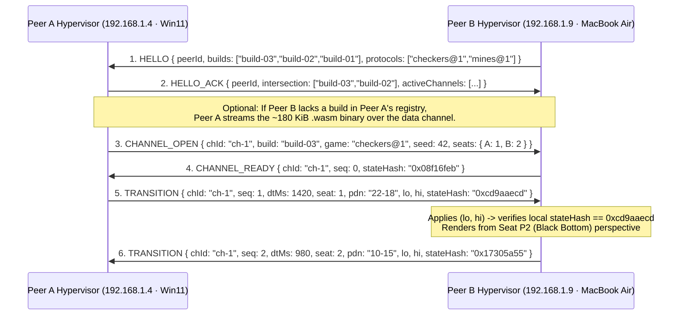

# Peer-to-Peer Entangled Hypervisors with Live Trajectory Branching

> **Durable Architectural Manifesto & Protocol Specification (`v3.1+` / `v4.0`)**  
> *Read this before designing any multiplayer, networking, replay, or AI agent integration for `wasm-fb`.*

---

## 1. Purpose: Curing Context-Window Amnesia

When a new developer or autonomous coding agent approaches a browser-hosted application and hears *"multiplayer,"* *"LAN sync,"* *"replay,"* or *"agent control,"* standard training priors pull toward 2020s client/server web patterns:
- Central authoritative game servers with master/slave state replication and rubber-banding interpolation.
- WebRTC video stream capture (`canvas.captureStream()`) or multi-megabyte JSON state dumps for session recording.
- Vision-Language Model (VLM) screenshot scraping for AI agent observation.

**Every one of those patterns is an anti-pattern in `wasm-fb`.**

Because `wasm-fb` is built on a **cryptographically pinned, zero-dependency `#![no_std]` WebAssembly state machine (`< 190 KiB`)** where state transitions and perspective rendering are strictly decoupled, it unlocks a fundamentally superior paradigm:

$$\textbf{Peer-to-Peer Entangled Hypervisors with Live Trajectory Branching}$$

---

## 2. The Five Foundational Laws

### Law 1 — The Kernel is a Pure Causal Function
Every guest appliance (`build-01`, `build-02`, `build-03`, ...) in [`web/registry.json`](../web/registry.json) is a deterministic state machine with **zero hidden entropy**:
- No internal `Math.random()` or unseeded entropy.
- No wall-clock reads inside game or state transitions.
- No DOM, network, or asynchronous callbacks inside the Wasm guest.

Given an immutable build digest $B$, an initial seed $S_0$, and an ordered sequence of causal transitions $\vec{\tau}_N = [\tau_1, \tau_2, \dots, \tau_N]$, the state at step $N$ is a pure mathematical function:

$$\text{State}_N = F(B, S_0, [\tau_1, \tau_2, \dots, \tau_N])$$

### Law 2 — State-Space Entanglement (Denial of Master/Slave Parity)
When two JavaScript hypervisors connect—whether in two tabs on one machine, across a LAN (`192.168.1.4` Windows 11 $\leftrightarrow$ `192.168.1.9` MacBook Air), or across the internet—**there is no "Master" and no "Slave."**

1. **Symmetric Peerage**: Both hypervisors instantiate the exact same pinned `.wasm` module $B$ from `registry.json`.
2. **Causal Transition Exchange**: Peers never transmit board arrays, structs, or pixel buffers. They exchange only compact causal transitions:
   $$\tau_k = (\text{seq}_k, \Delta t_{\text{ms}}, \text{actor}, \text{op}, H_k)$$
   where $H_k$ is the 32-bit FNV-1a state hash (`app_checkers_state_hash()` / `app_fb_hash()`).
3. **Zero-Noise Convergence**: Upon applying $\tau_k$, each peer computes its local state hash $H_k^{\text{local}}$. If $H_k^{\text{local}} == H_k$, both machines are mathematically guaranteed to co-inhabit the exact same state space. No error correction, dead reckoning, or state reconciliation polling is ever required.

### Law 3 — Orthogonal Perspective Projection (Same Truth, Different Lens)
In `wasm-fb`, **state is shared; perspective is local**:

$$\text{Framebuffer}_i = \text{Render}(\text{State}_N, \text{Lens}_i)$$

Two entangled hypervisors holding the identical $\text{State}_N$ (`0x17305a55`) can simultaneously project it through completely different local lenses:
- **Peer A (Windows 11 Laptop)**: Renders $\text{State}_N$ as **Seat P1 (Red at bottom)**, `1280×720` landscape, Smooth font mode, `Cyberpunk` theme.
- **Peer B (MacBook Air)**: Renders $\text{State}_N$ as **Seat P2 (Black at bottom, auto-flipped board)**, `1920×1080` HD or `390×844` mobile portrait, `Solarized` theme.
- **Peer C (Autonomous Agent / Spectator)**: Consumes $\text{State}_N$ directly via the C-ABI (`[f32; 64]` observation tensor or 32-square bitboard) without rasterizing pixels at all.

### Law 4 — Live Trajectory Branching (Counterfactual Time-Travel)
Because a transition $\tau_k$ is ~8–16 bytes and executing `apply_hop` / `step` in Wasm takes **~2 microseconds**, a match history $\vec{\tau}_N$ is not a passive log—it is a **branchable world-line**:
- **Zero-Bandwidth "Video"**: A 50-turn match with millisecond pacing ($\Delta t_{\text{ms}}$) is ~600 bytes. Re-applying $\vec{\tau}_N$ from $k = 0 \dots N$ reconstructs every intermediate RGBA8888 framebuffer pixel-for-pixel down to the millisecond.
- **Counterfactual Forking**: At any point in a live match (e.g., Turn `#14`), a human player or an autonomous sub-agent can **fork** $\vec{\tau}_{14}$ into a new guest instance (`vm-03`), inject an alternative move $\tau'_{15}$, run 6-ply Minimax or a Monte Carlo rollout 20 turns into the future in `< 5 ms`, and visually compare the forked universe side-by-side in Split View without mutating the live match on `vm-01` / `vm-02`.

### Law 5 — Actor Agnosticism & The Actor Matrix
To the Wasm kernel and the hypervisor bus, every participant is simply an actor emitting valid transitions $\tau_k$. The chassis surfaces the active driver via real-time **Actor Matrix Badges**:
- **`[👤 Human]`**: Local physical pointer/keyboard input (`app_click`, `app_key_mods`).
- **`[🤖 Minimax]`**: Built-in `#![no_std]` alpha-beta Minimax AI (`app_checkers_step_ai`, `app_chess_step_ai`).
- **`[✈️ AutoPilot]`**: Scripted multi-VM flight plans or autonomous sub-agents executing deterministic trajectories via `window.__appliance.autoPilot`.
- **`[🌐 Remote Peer]`**: Remote LAN peer over WebRTC `RTCDataChannel` or LAN WebSocket (`app_checkers_apply_rx`, `app_mines_apply_rx`).

Regardless of who drives a seat, each transition updates the FNV-1a hash ledger identically, allowing seamless transitions where AutoPilot opens a game, Minimax responds to counter-attacks, and a human spectator intervenes on any move.

---

## 3. LAN Entanglement & Capability Handshake Protocol



### 3.1 Capability Negotiation (`HELLO` / `HELLO_ACK`)
When Peer B connects to Peer A:
1. Both hypervisors exchange their loaded [`web/registry.json`](../web/registry.json) manifests (`builds` + SHA/FNV digests + supported game protocols `checkers@1`, `mines@1`).
2. They compute the **Executable Intersection**: which appliance versions and multi-guest protocols both peers can run.
3. **Self-Healing Binary Sync**: Because every appliance build is a single self-contained `.wasm` file under `190 KiB`, if Peer A has `build-04` and Peer B only has up to `build-03`, Peer A can transmit the raw `.wasm` ArrayBuffer over the peer channel in `< 20 ms` on a local LAN, allowing Peer B to compile and instantiate it on the fly.

### 3.2 Multiplexed Entanglement Channels
A single LAN connection between two hypervisors can multiplex multiple independent channels simultaneously:
- **`ch-01`**: `build-03` (`v3.1`) running a 2-Player Checkers match (`vm-01` on Laptop A $\leftrightarrow$ `vm-01` on Laptop B).
- **`ch-02`**: `build-02` (`v3.0`) running a 2-Player Minesweeper match (`vm-02` on Laptop A $\leftrightarrow$ `vm-02` on Laptop B).
- **`ch-03`**: A forked trajectory (`branch_of: "ch-01@seq=8"`) where both players test an alternate line in `vm-03`.

### 3.3 Transport Agnosticism (In-Tab, Cross-Tab, LAN Sidecar, WebRTC)
Because the entanglement protocol is purely message-based JSON/binary frames over an abstract `PeerTransport` interface, the exact same `FastApiSqliteBroker` and trajectory engine work across four transports without changing a single line of Wasm:
1. **In-Page (`LoopbackTransport`)**: Two guests (`vm-01`, `vm-02`) in Split View inside one browser tab (implemented in `v3.0` / `v3.1`).
2. **Same-Machine Cross-Tab (`BroadcastChannel('wasm-fb-entangle')`)**: Zero-config instant entanglement across multiple browser windows on the same machine.
3. **LAN WebSocket Relay (`ws://192.168.1.4:8788/entangle`)**: A 60-line stateless broadcast relay included in the local dev/container server (`make serve`) so any laptop on the subnet can type `192.168.1.4` and pair immediately.
4. **Direct LAN WebRTC (`RTCDataChannel`)**: Serverless peer-to-peer UDP/SCTP data channel between browsers on `https://wasm-fb.livive.net/`.

---

## 4. Trajectory Envelope Schema (`.trajectory.json`)

Every match in the SQLite `matches` and `match_events` tables (and any exported/forked trajectory) adheres to this canonical, replayable envelope:

```json
{
  "schema": "wasm-fb.trajectory/v1",
  "buildId": "build-03",
  "gitCommit": "d702ae3",
  "game": "checkers@1",
  "seed": 42,
  "initialHash": "0x08f16feb",
  "parentBranch": null,
  "events": [
    { "seq": 1, "dtMs": 1420, "seat": 1, "action": 1, "lo": 1193046, "hi": 0, "pdn": "22-18", "stateHash": "0xcd9aaecd" },
    { "seq": 2, "dtMs": 980,  "seat": 2, "action": 1, "lo": 996147,  "hi": 0, "pdn": "10-15", "stateHash": "0x17305a55" }
  ]
}
```

### How to Fork a Trajectory in `< 1 ms`:
1. Instantiate a guest with `buildId` (`WebAssembly.instantiate(cachedModule)` takes `~0.8 ms`).
2. Initialize with `seed`.
3. Loop `k = 1 .. branchSeq` calling `app_checkers_apply_rx` (or `app_mines_apply_rx`), asserting `stateHash` at `branchSeq`.
4. Render once (`app_render()`) and hand control of the branched universe to the user or agent.
